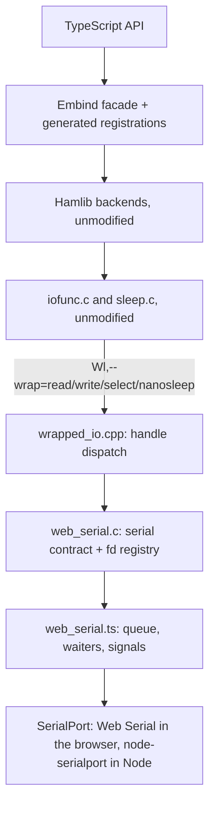

# hamlib-wasm

Run [Hamlib](https://hamlib.github.io/) in the browser.

`hamlib-wasm` compiles the pinned Hamlib release to WebAssembly, replaces only its common
serial transport with a switchable one - the
[Web Serial API](https://developer.mozilla.org/docs/Web/API/Web_Serial_API) in
the browser and
[node-serialport](https://serialport.io/) in Node and Electron, each selected by
the runtime that loads the module - and exposes the
compiled CAT operations as promise based TypeScript methods.
Radio backends are upstream Hamlib code and are not modified, so ordinary
serial CAT rigs work without per-model browser or Node code.

Five entry points, so it is always clear which surface is in use:

| Import | What it is |
| --- | --- |
| `hamlib-wasm` | The easy surface: `createEasy`, a state snapshot, events, booleans |
| `hamlib-wasm/hamlib` | The 1:1 surface: `createHamlib`, a method per upstream Hamlib call |
| `hamlib-wasm/native` | The raw Emscripten module and its generated declaration, for advanced use |
| `hamlib-wasm/node` | The Node transport: `nodeSerialTransport`, with `serialport` as an optional peer dependency |
| `hamlib-wasm/react` | React hooks over the easy surface (`hamlib-wasm/react` needs `react`) |

```ts
import { createEasy } from 'hamlib-wasm';

const hamlib = await createEasy();
const rig = await hamlib.open({ modelId });       // asks for the port: user gesture

const { frequency, mode, passband } = await rig.refresh();  // only advertised fields
await rig.setFrequency(14_074_000);
await rig.setMode('USB');                         // passband filled in from the model
await rig.setPtt(true);                           // an explicit on command, not a toggle

rig.on('state', console.log);                     // or rig.watch(1000) to poll
await rig.close();
await hamlib.dispose();
```

The 1:1 entry adds no behaviour of its own: every CAT operation is a generated
method on `Rig`, named after the upstream Hamlib call it binds, and a composite
read is as many calls as it takes.  `Rig` carries the whole generated surface,
so anything the easy entry does not cover is still one call away.

```ts
import { createHamlib } from 'hamlib-wasm/hamlib';

const hamlib = await createHamlib();
const port = await hamlib.requestPort();          // needs a user gesture
const rig = await hamlib.open({ modelId, port }); // modelId from hamlib.models

const frequency = await rig.getFrequency();       // Hz
const mode = await rig.getMode();                 // { mode, passband }
await rig.setFrequency(14_074_000);
await rig.setMode('USB', await rig.passbandNormal('USB'));
await rig.setPtt('on');

await rig.close();
await hamlib.dispose();
```

## Layout

| Path | Purpose |
| --- | --- |
| `packages/hamlib-wasm` | The package: native sources, build scripts, the five entry points (`src/index.ts`, `src/hamlib.ts`, `src/native/`, `src/react.ts`, `src/node.ts`) |
| `packages/hamlib-wasm/hamlib.config.yaml` | The one config: the pinned release (version, archive URL + SHA-256, patches) and the binding surface |
| `packages/hamlib-wasm/coverage.json` | Generated coverage report: bound vs refused declarations, with reasons |
| `packages/hamlib-wasm/build` | Native build, package build, audits and the generator wrapper |
| `packages/hamlib-codegen` | The AST-driven generator: classifies upstream declarations and emits the binding surface |
| `packages/hamlib-wasm/native` | Browser serial transport (TypeScript, compiled to the Emscripten JS library), link-time POSIX wrappers, Embind facade, `pthread` shim |
| `packages/hamlib-wasm/baseline/baseline.json` | Recorded catalogue digest and CAT trace for the pinned release |
| `examples/basic` | Vanilla TypeScript/Vite example of the 1:1 surface |
| `examples/node` | Node CLI: lists this machine's serial ports and drives a rig read-only through the Node transport |
| `examples/react` | React landing page and demo: one graphical rig, the easy and native backends side by side |
| `tests/browser` | Playwright Web Serial double with emulated rigs (Kenwood TS-480, Icom CI-V IC-703/IC-746, Yaesu FT-757GXII and FRG-100) and the scenarios driving them |
| `tests/hooks` | `vitest` + jsdom: the React hook state machine against a stubbed package boundary |
| `tests/node` | `vitest` in Node: the built Wasm module, the port contract and the `serialport` adapter against the emulated rigs |
| `tests/hardware` | Opt-in, read-only checks against a real rig through the shipped Node transport |
| `tests/harness` | Pages that publish the built package (`index.html`) and drive the React hooks (`hooks.html`) for the specs |
| `tests/consumer` | External consumer fixture, typechecked against the packed tarball |
| `.github/workflows/pages.yml` | Builds `examples/react` and publishes it to GitHub Pages |
| `docs` | Investigation notes, the implementation plan and the implementation record |

Build products live in `.cache/hamlib/<version>` (downloaded upstream source and
object files) and `packages/hamlib-wasm/dist`; neither is committed.

## Commands

Everything goes through the pinned toolchain in `mise.toml` (Node 24.21.0,
emsdk 6.0.10):

```sh
mise install && mise run bootstrap   # toolchain, locked npm deps, Playwright Chromium
mise run build                       # Hamlib wasm, package, both examples
mise run fetch-native                # fetch, verify, patch and extract the pinned release
mise run generate                    # regenerate the binding surface from the config + upstream AST
mise run baseline-record             # re-record the upstream behavioural baseline
mise run typecheck                   # every project, including the packed-consumer fixture
mise run test                        # hook/Node unit tests + deterministic transport/browser scenarios
mise run test-hooks                  # only the DOM-less React hook unit tests
mise run test-node                   # only the Node transport checks against the built package
mise run test-hardware               # read-only checks against a real attached rig (opt-in)
mise run example-node                # list this machine's serial ports through the Node entry point
mise run refresh                     # the whole upstream refresh path, end to end
mise run pack-package                # verify the published package contents
mise run verify-package              # verify the actual npm tarball
mise run verify-relink               # clean-room relink with modified Hamlib
mise run verify-release              # package + relink concurrently
mise run release-bump -- --version … # update the pinned Hamlib release
mise run dev                         # Vanilla example dev server
mise run dev-react                   # React landing page dev server
```

`mise run build` is reproducible: it reads
`packages/hamlib-wasm/hamlib.config.yaml`, downloads the release it names,
verifies its SHA-256, extracts a fresh tree, applies the patches it lists
strictly (no fuzz, no rejects), installs the project owned `src/serial.c`,
configures a static single threaded Emscripten build, checks the committed
generated files against the upstream headers, links, and verifies the emitted
Embind declaration against that same config.

### Upstream refresh

`hamlib.config.yaml` is the only place that names an upstream release:

```yaml
release:
  version: <version>
  archive: { name: …, url: …, sha256: … }
  patches: [{ file: hamlib-<version>-web.patch, purpose: … }]
```

Moving to another release is a config edit (or `mise run release-bump`) followed by `mise run refresh`,
which fetches, adapts, generates, builds, typechecks, runs the browser suite
and checks the packed consumer. Every step fails loudly rather than drifting:

| Drift | Where it stops |
| --- | --- |
| Patch no longer applies | strict `patch --fuzz=0` in `build/fetch-native.ts` |
| A pinned upstream signature changed | `packages/hamlib-codegen` names the symbol and prints the old and new signature |
| The generated files in git are stale | `codegen --check`, run by the native build and by `mise run typecheck` |
| The linked module exposes a different surface | the emitted `.d.mts` is compared with the config |
| The catalogue or the CAT traffic moved | `tests/browser/baseline.spec.ts` compares a recorded digest and wire trace |
| The runtime version disagrees with the shipped provenance | `tests/browser/baseline.spec.ts` |

## How it works



* **Synchronous C, asynchronous browser** - Hamlib's API is blocking, Web
  Serial is promise based. `emscripten_sleep()` and the `__async: "auto"` JS
  imports let Emscripten's Asyncify suspend the C stack while a browser promise
  settles.
* **The transport is replaced, not patched in** - `native/web_serial.c` stands
  in for upstream's `src/serial.c`, and `native/wrapped_io.c` redirects the
  `read()`/`write()`/`select()`/`nanosleep()` calls the common port layer makes
  for a serial port to it (linked with `-Wl,--wrap=`). Upstream's own read
  loop, 7 data bit masking, retry accounting and timeout handling stay in
  charge, and `src/iofunc.c` and `src/sleep.c` are compiled untouched.
* **One upstream patch hunk** - the pinned patch skips only the Morse worker
  start in `rig_open()`, which the single threaded build cannot support.
  Everything else `rig_open()` does still runs, including the backend open, the
  retry restore and the initial state read.
* **Public API only in the facade** - `native/facade.cpp` reaches Hamlib
  through `rig_init()`/`rig_open()`/`rig_close()` and
  `rig_token_lookup()` + `rig_set_conf()`; it never writes a `rig_state` or
  `hamlib_port_t` field, so no internal header leaks into the adapter.
* **Fake descriptors** - `hamlib_port_t.fd` holds an opaque positive handle
  owned by the JavaScript registry; `serial/<n>` is the logical path Hamlib
  passes around.
* **One port contract, two transports** - `src/transport.ts` defines the
  `SerialTransport`/`SerialPortLike` seam the facade acquires ports through.
  Web Serial satisfies it structurally (`src/web-serial.ts`), and
  `hamlib-wasm/node` (`src/node.ts`) adapts `serialport` to it, lazily and behind
  an optional peer dependency, so the same package, the same Hamlib build and
  the same catalogue run in an Electron main process, a CLI or a test with no
  browser present.  With no transport passed, the runtime picks: Web Serial
  where it exists, the Node transport otherwise (`src/transport-select.ts`).
* **One queue per module** - every native call runs on a single promise chain,
  because Asyncify can only have one suspended call at a time. Several `Rig`
  objects still work; their calls are serialized in order. This includes the
  `pure` helpers that read only `rig_caps`: they make no CAT traffic, but they
  still enter the Wasm module, which must not be re-entered while a call is
  suspended.
* **Compound operations** - an easy method that needs several native calls (the
  passband lookup plus write of `setMode()`, the mode read plus write of
  `setPassband()`, every read of `refresh()`) takes one queue slot, so a raw
  call, another rig's call or a later easy call cannot run between its steps.
  The guarantee covers the commands the library issues; it cannot see someone
  turning the radio's physical controls between two CAT replies. `refresh()`
  reads only the getters the model advertises, so a snapshot may omit a field,
  and a read that fails leaves the previous snapshot in place instead of
  publishing a partial one.
* **Owned connections** - an easy instance tracks every rig it opened and
  invalidates superseded connection attempts, so `dispose()`, unmount and a
  replacement connection cannot leave an obsolete attempt owning the port:
  what it opened is closed again instead of published. Polling is
  subscription-based, so several consumers can watch one rig; the last
  unsubscribe, `close()` and `dispose()` each stop the scheduler.
* **Hamlib's cache is left intact** - its setters keep the 500 ms cache
  coherent, so a read after a write reports what was just written (notably for
  PTT, where the Kenwood backend additionally caches its `IF` response).
* **An open means the rig answered** - the rate a rig answers at is a setting on
  the rig, and Hamlib defaults to the *highest* rate a model advertises
  (`caps->serial_rate_max`). A rig behind a real UART hears one rate only, so
  opening it at another produces silence, not an error - and `rig_open()` reads
  the rig state blind, discarding the result, so the silence used to surface as
  a "connected" rig whose every read failed. A model whose open performs that
  read (`get_freq`) must therefore have sent something back; when the transport
  saw not a byte on the path, the open is rejected with the rate it tried and
  the range the model declares. `detectBaudRate()` searches the declared range
  for a rig whose rate is unknown, and `Rig.baudRate` reports the rate in use so
  a reconnect can pass it straight back: the rate is either stated or searched,
  never guessed into a success.
* **Single threaded** - the module is built without `-pthread`, with `async`,
  `poll_interval` and `auto_power_on`/`auto_power_off` forced to zero through
  Hamlib's public configuration, so no polling thread, async data handler or
  Morse worker can start. `RTS`/`DTR`/`BREAK` map to `setSignals()`,
  `CTS`/`DCD`/`DSR` to `getSignals()`.
* **Generated bindings** - the Embind registrations, the low-level TypeScript
  contract and every `Rig` method come from the pinned headers: the generator
  classifies each upstream declaration and emits it, or refuses it with a
  reason in `coverage.json`. `hamlib.config.yaml` declares the value objects
  and the handful of operations whose C++ body a signature cannot describe.
  Handwritten: the transport, resource ownership serialization and the module
  lifecycle.
* **The reference client decides the surface** - a declaration is bound because
  the upstream `rigctl`/`rigctld` sources call it, and one they never call is
  refused with that reason. Today that is 89 generated operations plus 11 whose
  C++ body is hand-written (the caller-buffer, table-walker, extended-setting
  and PTT shapes): 100 methods on `Rig`, against 87 refusals.
  `docs/implementation.md` lists which refusals are irreducible (credentials, a
  second thread, a caller-owned array) and which are this build's policy.

## Supported

Serial CAT control, in a secure context desktop Chromium family browser over
Web Serial and anywhere Node 24+ runs over node-serialport: frequency, mode,
passband and PTT for the models Hamlib reports as `RIG_PORT_SERIAL`, including
CAT based PTT and serial RTS/DTR PTT.

What the entries cover:

| Entry | Surface |
| --- | --- |
| `hamlib-wasm` | `createEasy`, `EasyRig` (`refresh`, `setFrequency`, `setMode`, `setPassband`, `setPtt`, `baudRate`, `on`, `watch`), `detectBaudRate` and `EasyRig.raw` for everything below; `refresh` returns only the fields the model advertises and `watch` registers composable polls |
| `hamlib-wasm/hamlib` | 100 methods on `Rig`, one per bound Hamlib operation, plus `baudRate`, `detectBaudRate`, the catalogue and the error type |
| `hamlib-wasm/native` | The raw Emscripten module, its generated declaration and the Wasm asset |
| `hamlib-wasm/node` | `nodeSerialTransport()` behind the same `SerialTransport` contract, `listPorts()` for what the operating system reports, and `requestPort({ path })` |
| `hamlib-wasm/react` | `HamlibProvider`, `useModels`, `useEasyRig`, `useRigState`, `useRigError` |

Not represented: Firefox/Safari, raw USB/HID, network rigs, rotators,
amplifiers, audio, GPIO and parallel ports. The transport contract cannot
express 5/6 data bits, mark/space parity or XON/XOFF flow control - the same
limits apply to both transports - so a model that declares those is rejected
with `-RIG_ECONF` before the port is opened, and the catalogue says so through
`RigModel.limitation`.

Every model carries a support level: `"verified"` when a browser test in
`tests/browser` drives it through the Web Serial double, otherwise
`"candidate"`. `VERIFIED_MODELS` and `UNUSABLE_MODELS` in
`packages/hamlib-wasm/src/browser-support.ts` hold the evidence and the recorded
reasons. Three limitations are worth knowing:

* a backend that needs a worker thread (AnyTone D578A) fails at open rather
  than degrading quietly;
* the only serial model that drives push-to-talk over the DTR line (Yaesu
  FT-757GXII) cannot open at all: it reads a 75 octet status block through a
  helper whose retry count Hamlib has already zeroed. The DTR/RTS signal path
  itself is still covered at the transport seam by
  `tests/browser/transport-primitives.spec.ts`;
* a rig behind a real UART answers at one rate only - the rate its own menu is
  set to, which no model metadata carries - so opening it at anything else
  opens a port nothing answers on, and the open is rejected rather than
  reported as a connection. `detectBaudRate()` tries the rates the model
  declares; a rig whose interface ignores the line rate (a USB CDC-ACM one, such
  as the QRP Labs QMX+) is unaffected either way.

Verified models are covered by `tests/browser/baseline.spec.ts`,
`transport.spec.ts`, `protocols.spec.ts` and `baud-rate.spec.ts` (Kenwood
TS-480, Icom CI-V and Yaesu newcat) and the example-driven scenarios in
`tests/browser/e2e`.

## Licensing

This is a mixed-license repository. Original project code is MIT; Hamlib stays
LGPL-2.1-or-later and is linked statically into
`packages/hamlib-wasm/dist/native/hamlib-wasm.wasm`. The npm tarball is
therefore not MIT-only and uses `"license": "SEE LICENSE IN LICENSE.md"`.

The package carries:

- `LICENSE.md`, `LICENSES/` and `THIRD_PARTY_NOTICES.md` — the component map
  and complete license texts.
- `dist/third_party/hamlib/` — upstream `LICENSE`, `COPYING`, `COPYING.LIB`,
  `AUTHORS`, the applied patch and `SOURCE.json` (release, commit, hashes).
- `dist/third_party/hamlib/corresponding-source.tar.gz` — the complete
  corresponding-source/relink kit: the pinned Hamlib archive, patch, native
  bridge, generated bindings and `rebuild.sh`.
- `REBUILDING.md` — tested instructions for rebuilding the WASM with a
  modified Hamlib.

The full upstream archive contains GPL-2.0-or-later utilities/examples and the
GPL-3.0-or-later `lib/precise_time.c`; those files are corresponding source,
not linked objects. The build redirects `monotonic_seconds()` to the MIT
implementation in `native/monotonic_time.c` and `LINK_INPUTS.json` records the
linked archive members, which contain no GPL-only object.

`mise run verify-package` packs the workspace and verifies the actual tarball;
`mise run verify-relink` performs the clean-room relink test. See
`docs/licensing-audit.md` for the evidence inventory.
