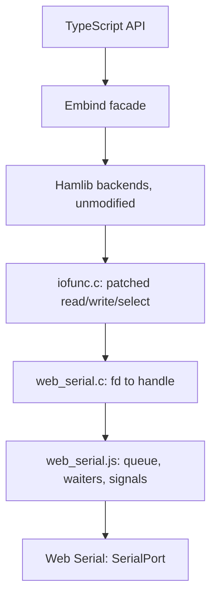

# hamlib-web

Run [Hamlib](https://hamlib.github.io/) in the browser.

`hamlib-web` compiles Hamlib 4.7.2 to WebAssembly, replaces only its common
serial transport with the [Web Serial API](https://developer.mozilla.org/docs/Web/API/Web_Serial_API),
and exposes a small promise based TypeScript API. Radio backends are upstream
Hamlib code and are not modified, so ordinary serial CAT rigs work without
per-model browser code.

```ts
import { createHamlib } from 'hamlib-web';

const hamlib = await createHamlib();
const port = await hamlib.requestPort();          // needs a user gesture
const rig = await hamlib.open({ modelId, port }); // modelId from hamlib.models

const status = await rig.getStatus();             // { frequency, mode, passband }
await rig.setFrequency(14_074_000);
await rig.setMode('USB');
await rig.setPtt('on');

await rig.close();
await hamlib.dispose();
```

## Layout

| Path | Purpose |
| --- | --- |
| `packages/hamlib-web` | The package: native sources, build scripts, public TypeScript API |
| `packages/hamlib-web/native` | Browser serial transport, Embind facade, `pthread` shim, upstream patch |
| `examples/basic` | Vanilla TypeScript/Vite example application |
| `tests/browser` | Playwright Web Serial double, TS-480 emulator and scenarios |
| `tests/harness` | Page that publishes the built package for the transport specs |
| `tests/consumer` | External consumer fixture, typechecked against the packed tarball |
| `docs` | Investigation notes and the implementation plan |

Build products live in `.cache/hamlib/4.7.2` (downloaded upstream source and
object files) and `packages/hamlib-web/dist`; neither is committed.

## Commands

Everything goes through the pinned toolchain in `mise.toml` (Node 24.21.0,
emsdk 6.0.10):

```sh
mise install && mise run bootstrap   # toolchain, locked npm deps, Playwright Chromium
mise run build                       # Hamlib wasm, package, example
mise run typecheck                   # package, example and packed-consumer typecheck
mise run test                        # deterministic transport checks + browser scenarios
mise run pack:check                  # verify the published package contents
mise run dev                         # example dev server
```

`mise run build` is reproducible: it downloads the pinned Hamlib 4.7.2 release,
verifies its SHA-256, extracts a fresh tree, applies
`packages/hamlib-web/native/patches/hamlib-4.7.2-web.patch`, installs the
project owned `src/serial.c`, and configures a static, single threaded
Emscripten build.

## How it works



* **Synchronous C, asynchronous browser** - Hamlib's API is blocking, Web
  Serial is promise based. `emscripten_sleep()` in `src/sleep.c` and the
  `__async: "auto"` JS imports let Emscripten's Asyncify suspend the C stack
  while a browser promise settles.
* **Fake descriptors** - `hamlib_port_t.fd` holds an opaque positive handle
  owned by the JavaScript registry; `webserial/<n>` is the logical path Hamlib
  passes around.
* **One queue per module** - every native call runs on a single promise chain,
  because Asyncify can only have one suspended call at a time. Several `Rig`
  objects still work; their calls are serialized in order.
* **Hamlib's cache is left intact** - its setters keep the 500 ms cache
  coherent, so a read after a write reports what was just written (notably for
  PTT, where the Kenwood backend additionally caches its `IF` response).
* **Single threaded** - the module is built without `-pthread`, with
  `async_data_enabled`, `poll_interval` and `asyncio` forced to zero and
  Hamlib's `skip_init` set for `rig_open()`, so no polling thread, async data
  handler or Morse worker can start. `RTS`/`DTR`/`BREAK` map to
  `setSignals()`, `CTS`/`DCD`/`DSR` to `getSignals()`.

## Supported

Web Serial CAT control in a secure context desktop Chromium family browser:
frequency, mode, passband and PTT for the models Hamlib reports as
`RIG_PORT_SERIAL`, including CAT based PTT and serial RTS/DTR PTT.

Not represented: Firefox/Safari, raw USB/HID, network rigs, rotators,
amplifiers, audio, GPIO and parallel ports. Web Serial cannot express 5/6 data
bits, mark/space parity or XON/XOFF flow control; those configurations are
rejected with `-RIG_ECONF` instead of being silently downgraded. A rig whose
backend needs a helper thread fails at runtime rather than degrading quietly.

## Licensing

The project code is `UNLICENSED` and every workspace package is private.
Hamlib itself stays LGPL-2.1-or-later; its licence, pinned source URL/checksum
and the applied patch ship inside the package under `dist/third_party/hamlib`
(and are exposed as `hamlib-web/third_party/*`).
