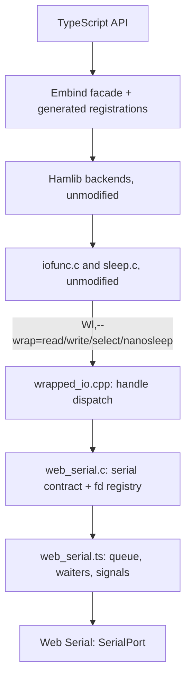

# hamlib-web

Run [Hamlib](https://hamlib.github.io/) in the browser.

`hamlib-web` compiles Hamlib 4.7.2 to WebAssembly, replaces only its common
serial transport with the [Web Serial API](https://developer.mozilla.org/docs/Web/API/Web_Serial_API),
and exposes the compiled CAT operations as promise based TypeScript methods.
Radio backends are upstream Hamlib code and are not modified, so ordinary
serial CAT rigs work without per-model browser code.

```ts
import { createHamlib } from 'hamlib-web';

const hamlib = await createHamlib();
const port = await hamlib.requestPort();          // needs a user gesture
const rig = await hamlib.open({ modelId, port }); // modelId from hamlib.models

const frequency = await rig.getFrequency();       // Hz
const mode = await rig.getMode();                 // { mode, passband }
await rig.setFrequency(14_074_000);
await rig.setMode('USB', await rig.passbandNormal('USB'));
await rig.setPtt('on');

await rig.close();
await hamlib.dispose();
```

Every CAT operation is a generated method on `Rig`, named after the upstream
Hamlib call it binds; the library adds no convenience wrappers of its own.

## Layout

| Path | Purpose |
| --- | --- |
| `packages/hamlib-web` | The package: native sources, build scripts, public TypeScript API |
| `packages/hamlib-web/hamlib.config.yaml` | The one config: the pinned release (version, archive URL + SHA-256, patches) and the binding surface |
| `packages/hamlib-web/coverage.json` | Generated coverage report: bound vs refused declarations, with reasons |
| `packages/hamlib-web/build` | Native build, package build, audits and the generator wrapper |
| `packages/hamlib-codegen` | The AST-driven generator: classifies upstream declarations and emits the binding surface |
| `packages/hamlib-web/native` | Browser serial transport (TypeScript, compiled to the Emscripten JS library), link-time POSIX wrappers, Embind facade, `pthread` shim |
| `packages/hamlib-web/baseline/baseline.json` | Recorded catalogue digest and CAT trace for the pinned release |
| `examples/basic` | Vanilla TypeScript/Vite example application |
| `tests/browser` | Playwright Web Serial double, emulated TS-480/Icom/Yaesu rigs and scenarios |
| `tests/harness` | Page that publishes the built package for the transport specs |
| `tests/consumer` | External consumer fixture, typechecked against the packed tarball |
| `docs` | Investigation notes, the implementation plan and the implementation record |

Build products live in `.cache/hamlib/<version>` (downloaded upstream source and
object files) and `packages/hamlib-web/dist`; neither is committed.

## Commands

Everything goes through the pinned toolchain in `mise.toml` (Node 24.21.0,
emsdk 6.0.10):

```sh
mise install && mise run bootstrap   # toolchain, locked npm deps, Playwright Chromium
mise run build                       # Hamlib wasm, package, example
mise run fetch-native                # fetch, verify, patch and extract the pinned release
mise run generate                    # regenerate the binding surface from the config + upstream AST
mise run baseline:record             # re-record the upstream behavioural baseline
mise run typecheck                   # every project, including the packed-consumer fixture
mise run test                        # deterministic transport checks + browser scenarios
mise run refresh                     # the whole upstream refresh path, end to end
mise run pack:check                  # verify the published package contents
mise run dev                         # example dev server
```

`mise run build` is reproducible: it reads
`packages/hamlib-web/hamlib.config.yaml`, downloads the release it names,
verifies its SHA-256, extracts a fresh tree, applies the patches it lists
strictly (no fuzz, no rejects), installs the project owned `src/serial.c`,
configures a static single threaded Emscripten build, checks the committed
generated files against the upstream headers, links, and verifies the emitted
Embind declaration against that same config.

### Upstream refresh

`hamlib.config.yaml` is the only place that names an upstream release:

```yaml
release:
  version: 4.7.2
  archive: { name: …, url: …, sha256: … }
  patches: [{ file: hamlib-4.7.2-web.patch, purpose: … }]
```

Moving to another release is a config edit followed by `mise run refresh`,
which fetches, adapts, generates, builds, typechecks, runs the browser suite
and checks the packed consumer. Every step fails loudly rather than drifting:

| Drift | Where it stops |
| --- | --- |
| Patch no longer applies | strict `patch --fuzz=0` in `build/fetch-native.ts` |
| A pinned upstream signature changed | `packages/hamlib-codegen` names the symbol and prints the old and new signature |
| The generated files in git are stale | `codegen --check`, run by the native build and by `mise run typecheck` |
| The linked module exposes a different surface | the emitted `.d.mts` is compared with the config |
| The catalogue or the CAT traffic moved | `tests/browser/baseline.spec.ts` compares a recorded digest and wire trace |
| The runtime version disagrees with the shipped provenance | `tests/browser/baseline.spec.ts` |

## How it works



* **Synchronous C, asynchronous browser** - Hamlib's API is blocking, Web
  Serial is promise based. `emscripten_sleep()` and the `__async: "auto"` JS
  imports let Emscripten's Asyncify suspend the C stack while a browser promise
  settles.
* **The transport is replaced, not patched in** - `native/web_serial.c` stands
  in for upstream's `src/serial.c`, and `native/wrapped_io.c` redirects the
  `read()`/`write()`/`select()`/`nanosleep()` calls the common port layer makes
  for a serial port to it (linked with `-Wl,--wrap=`). Upstream's own read
  loop, 7 data bit masking, retry accounting and timeout handling stay in
  charge, and `src/iofunc.c` and `src/sleep.c` are compiled untouched.
* **One upstream patch hunk** - the pinned patch skips only the Morse worker
  start in `rig_open()`, which the single threaded build cannot support.
  Everything else `rig_open()` does still runs, including the backend open, the
  retry restore and the initial state read.
* **Public API only in the facade** - `native/facade.cpp` reaches Hamlib
  through `rig_init()`/`rig_open()`/`rig_close()` and
  `rig_token_lookup()` + `rig_set_conf()`; it never writes a `rig_state` or
  `hamlib_port_t` field, so no internal header leaks into the adapter.
* **Fake descriptors** - `hamlib_port_t.fd` holds an opaque positive handle
  owned by the JavaScript registry; `webserial/<n>` is the logical path Hamlib
  passes around.
* **One queue per module** - every native call runs on a single promise chain,
  because Asyncify can only have one suspended call at a time. Several `Rig`
  objects still work; their calls are serialized in order.
* **Hamlib's cache is left intact** - its setters keep the 500 ms cache
  coherent, so a read after a write reports what was just written (notably for
  PTT, where the Kenwood backend additionally caches its `IF` response).
* **Single threaded** - the module is built without `-pthread`, with `async`,
  `poll_interval` and `auto_power_on`/`auto_power_off` forced to zero through
  Hamlib's public configuration, so no polling thread, async data handler or
  Morse worker can start. `RTS`/`DTR`/`BREAK` map to `setSignals()`,
  `CTS`/`DCD`/`DSR` to `getSignals()`.
* **Generated bindings** - the Embind registrations, the low-level TypeScript
  contract and every `Rig` method come from the pinned headers: the generator
  classifies each upstream declaration and emits it, or refuses it with a
  reason in `coverage.json`. `hamlib.config.yaml` declares the value objects
  and the handful of operations whose C++ body a signature cannot describe.
  Handwritten: the transport, resource ownership serialization and the module
  lifecycle.

## Supported

Web Serial CAT control in a secure context desktop Chromium family browser:
frequency, mode, passband and PTT for the models Hamlib reports as
`RIG_PORT_SERIAL`, including CAT based PTT and serial RTS/DTR PTT.

Not represented: Firefox/Safari, raw USB/HID, network rigs, rotators,
amplifiers, audio, GPIO and parallel ports. Web Serial cannot express 5/6 data
bits, mark/space parity or XON/XOFF flow control; a model that declares those
is rejected with `-RIG_ECONF` before the port is opened, and the catalogue says
so through `RigModel.limitation`.

Every model carries a support level: `"verified"` when a browser test in
`tests/browser` drives it through the Web Serial double, otherwise
`"candidate"`. `VERIFIED_MODELS` and `UNUSABLE_MODELS` in
`packages/hamlib-web/src/browser-support.ts` hold the evidence and the recorded
reasons. Two limitations are worth knowing:

* a backend that needs a worker thread (AnyTone D578A) fails at open rather
  than degrading quietly;
* the only serial model that drives push-to-talk over the DTR line (Yaesu
  FT-757GXII) cannot open at all: it reads a 75 octet status block through a
  helper whose retry count Hamlib has already zeroed. The DTR/RTS signal path
  itself is still covered at the transport seam by
  `tests/browser/transport-primitives.spec.ts`.

Verified models are covered by `tests/browser/baseline.spec.ts`,
`transport.spec.ts`, `protocols.spec.ts` (Kenwood TS-480 and Icom CI-V) and the
example-driven scenarios in `tests/browser/e2e`.

## Licensing

The project code is `UNLICENSED` and every workspace package is private.
Hamlib itself stays LGPL-2.1-or-later; its licence, pinned source URL/checksum
and the applied patch ship inside the package under `dist/third_party/hamlib`
(and are exposed as `hamlib-web/third_party/*`).

Hamlib is linked statically into `dist/native/hamlib-web.wasm`, so the source
that corresponds to the shipped binary has to stay reachable. The arrangement
is: `dist/third_party/hamlib/SOURCE.json` names the exact upstream release, the
archive URL and its SHA-256 and the patch text that was applied;
`packages/hamlib-web/hamlib.config.yaml` plus `mise run build:native`
reproduce the same artifact from that source, and the pack task keeps both in
the tarball. There is no install-time build step and no generated code that
cannot be reproduced from the repository.
