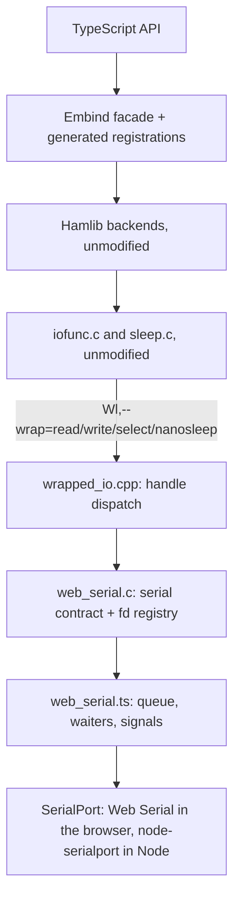

# hamlib-wasm

Run [Hamlib](https://hamlib.github.io/) CAT control in the browser and in Node.

`hamlib-wasm` compiles the pinned Hamlib release to WebAssembly and replaces only
its common serial transport with a switchable one - the
[Web Serial API](https://developer.mozilla.org/docs/Web/API/Web_Serial_API) in
the browser and [node-serialport](https://serialport.io/) in Node and Electron,
selected by the runtime that loads the module. The compiled CAT operations are
exposed as promise based TypeScript methods. Radio backends are upstream Hamlib
code and are not modified, so ordinary serial CAT rigs work without per-model
browser or Node code.

This package is licensed `MIT AND LGPL-2.1-or-later`: the original wrapper code
is MIT, and the included Hamlib WASM is LGPL-2.1-or-later. See
[Licensing](#licensing).

## Runtime support

| Runtime | Transport | Requirements |
| --- | --- | --- |
| Desktop Chromium-based browsers (Chrome, Edge, Opera, …) | Web Serial | A secure context (HTTPS or `localhost`) and a user gesture for the port chooser |
| Desktop Firefox 151+ | Web Serial | The same |
| Node 24+, an Electron main process | node-serialport | `serialport` installed (an optional peer dependency) |
| An Electron renderer | Web Serial | A `select-serial-port` handler in the main process |

Safari has no Web Serial. In a browser without it the package still loads and
lists the catalogue, and every port operation fails with
`TRANSPORT_UNAVAILABLE` - unless you pass a transport of your own.

## Entry points

| Import | What it is |
| --- | --- |
| `hamlib-wasm` | The default surface: `createHamlib({ levels })`, one `Rig` per connection (`refresh`, `level`, `setFrequency`, `setMode`, `setPassband`, `setPtt`, `baudRate`, `on`, `watch`), `detectBaudRate`, and `Rig.raw` for everything below |
| `hamlib-wasm/raw` | The raw surface: `createRawHamlib` and one method on `RawRig` per bound Hamlib operation, plus `baudRate`, `detectBaudRate`, the catalogue, the error type and the transport contract |
| `hamlib-wasm/node` | The node-serialport transport: `nodeSerialTransport()` with `listPorts()` and `requestPort({ path })`, for an Electron main process, a CLI or a test |
| `hamlib-wasm/react` | React hooks over the default surface: `HamlibProvider`, `useModels`, `useRig`, `useRigState`, `useRigError`; `react` is an optional peer dependency |

The Emscripten module itself is not an entry point: every native call goes
through one serialized queue (see [How it works](#how-it-works)), and a direct
module call would bypass it. Everything the module binds is a method on
`hamlib-wasm/raw`'s `RawRig`. `hamlib-wasm/native/hamlib-wasm.wasm` is exported
as an asset only, for applications that host the binary themselves (see
[Loading](#loading)).

## The default surface

```ts
import { createHamlib, HamlibError } from 'hamlib-wasm';
import type { Hamlib, Rig, RigState } from 'hamlib-wasm';

const hamlib: Hamlib = await createHamlib({ levels: ['STRENGTH'] });
hamlib.version;                       // "Hamlib <version> …"
hamlib.models;                        // RigModel[], sorted by manufacturer then model

const rig: Rig = await hamlib.open({ modelId });         // asks for the port: user gesture
rig.baudRate;                                          // the rate the port was opened at

const state: RigState = await rig.refresh();           // every field optional
state.frequency;                                       // Hz, or undefined when unreadable
rig.state;                                             // the last completed refresh, if any

await rig.setFrequency(14_074_000);
await rig.setMode('USB');                              // passband filled in from the model
await rig.setPassband('narrow');                       // current mode + width, in one compound
await rig.setPtt(true);

const stop = rig.watch({ intervalMs: 1000, fields: ['frequency', 'mode'] });
const stopMeter = rig.watch({ intervalMs: 500, levels: ['STRENGTH'] });  // one SM0 per tick
rig.on('state', (next) => console.log(next));
rig.on('levels', (values) => console.log(values.STRENGTH));
stop();
stopMeter();

await rig.level('STRENGTH');                           // one read, configured + advertised

rig.capabilities.setFrequency;                         // booleans, from rig_caps
rig.capabilities.levels;                               // configured levels the model has
rig.raw;                                               // the RawRig, for anything below

await rig.close();                                     // idempotent
await hamlib.dispose();                                // closes rigs, unregisters ports
```

What it adds, and what it deliberately does not:

* `refresh()` composes the reads a UI always wants into one snapshot and emits
  it as `state`.  It reads only the getters the model advertises: a field the
  model cannot read is omitted, never invented, so a frequency-only receiver
  yields a snapshot with `frequency` alone (`mode` and `passband` always appear
  together or not at all).  A supported read that fails throws and leaves the
  previous successful snapshot in place, and the `state` event only ever
  carries a completed refresh.
* Every method on `Rig` is one *compound* operation on the module queue: the
  passband lookup and the write of `setMode()`, all of `setPassband()` and all
  the reads of `refresh()`, run inside a single queue slot, so a raw call
  through `rig.raw`, a call on another rig or a later `Rig` call cannot
  interleave with their steps.  This orders the library's own commands; nothing
  can stop someone turning the radio's physical controls between two CAT
  replies.
* Every generated method takes that queue, including the `pure` helpers that
  read only `rig_caps` (`passband*`, the token codecs, the `has_*` masks, the
  `ext*` lookups).  They make no CAT traffic, but they still enter the Wasm
  module, which must not be re-entered while a native call is suspended under
  Asyncify.
* `setMode(mode)` fills in the passband through Hamlib's own
  `passband_normal`; pass one explicitly to override it.
* `setPassband('normal' | 'narrow' | 'wide')` reads the current mode, applies
  the matching Hamlib passband helper and writes mode and width back, all inside
  one compound operation - so a mode selection issued afterwards cannot be
  undone by the older passband action.
* `setPtt(true)` and `PttState` replace the string vocabulary.  It is an
  explicit on/off command, not a toggle: it never consults a readback, so it
  works on a model that can only set PTT.  The observed state is separate - read
  it from `state.ptt` (or the `ptt` event) and do not overwrite it with what was
  requested.
* A write never invents state - Hamlib's own cache decides what the next read
  reports - and a read the model cannot perform still fails with the native
  `UNSUPPORTED_OPERATION` error rather than returning a plausible value.
* `watch({ intervalMs, fields, levels })` registers a poll that reads only the
  fields it names.  Each interval runs its own timer, so a fast meter poll does
  not speed up a slow frequency poll; removing one registration leaves the
  others polling, and removing the last stops its timer.  A tick that arrives
  while that interval's previous poll is still in flight is skipped, so a slow
  rig cannot build a backlog of reads.  A tick is best effort - a field that
  fails emits `error` and leaves the rest of the snapshot untouched - while
  `refresh()` remains all-or-nothing.  `close()` and `dispose()` stop polling
  synchronously, cancel publication, and leave no timer behind, including when
  the underlying rig was closed through `rig.raw`.
* Events dispatch over a snapshot of their listeners: a listener that closes or
  disposes during dispatch does not cancel the event already on its way to the
  other listeners, but nothing further is published after the close - field
  events included.  Error listeners follow the same rule, and the failed
  command still rejects to its caller.
* Levels are opt-in.  `createHamlib({ levels })` names the ones the instance may
  read; the close/open gate costs one pure `has_get_level` call per configured
  level, and `refresh()`/`watch()` read only those the model advertises.  A
  level outside the configured set is `INVALID_ARGUMENT`; one the model does not
  report is `UNSUPPORTED_OPERATION`.  Hamlib's level cache is 500 ms, so polling
  a level faster than that mostly re-reads the cache.
* A level is decoration, not core telemetry: `refresh()` reads the core fields
  all-or-nothing and then reads levels best-effort, reporting a failed level as
  an `error` event while still returning the snapshot.  A level whose read
  fails twice in a row is dropped for the session - `has_get_level` describes
  what a backend declares, and a declared meter that cannot be read would
  otherwise cost the port timeout on every poll.  Reopening the rig re-probes
  it.
* `hamlib.open()` hands back one owned rig.  An instance tracks its
  handles, and an open that races with `dispose()` is closed again instead of
  being published, so `dispose()` never leaves a live wrapper or a port behind.
* The baud rate is either stated or searched, never guessed into a success.
  Omitting `baudRate` leaves Hamlib's own default, which is the *highest* rate
  the model advertises - and a rig behind a real UART answers at one rate only,
  the one its own menu is set to, producing silence rather than an error at any
  other.  Such an open is rejected with the rate it tried and the range the
  model declares, so a wrong rate reads as a wrong rate instead of as a
  connected rig whose every read fails.  When the rate is unknown, ask for one:

  ```ts
  const port = await hamlib.requestPort();
  const baudRate = await hamlib.detectBaudRate({ modelId, port });  // tries the declared range
  const rig = await hamlib.open({ modelId, port, baudRate });
  rig.baudRate;                                                     // 38400, say - keep it
  ```

  `rig.baudRate` reports the rate a live rig was opened at, so storing it
  (a cookie, a settings row, your own default) makes the next connect explicit
  and instant.  A rig whose USB interface ignores the line rate - a CDC-ACM one
  - is unaffected either way.

## The raw surface

```ts
import { createRawHamlib, HamlibError } from 'hamlib-wasm/raw';
import type { RawHamlib, RawRig, RigModel, RigMode, RigModeState } from 'hamlib-wasm/raw';

const hamlib: RawHamlib = await createRawHamlib();
const port = await hamlib.requestPort();          // requires a user gesture
const rig: RawRig = await hamlib.open({ modelId, port, baudRate: 19200 });

rig.baudRate;                                     // 19200: what this port was opened at
// Unknown rate? Search the range the model declares, then open with the answer:
// const baudRate = await hamlib.detectBaudRate({ modelId, port });

const frequency: number = await rig.getFrequency();
const mode: RigModeState = await rig.getMode();   // { mode, passband }
await rig.setFrequency(7_074_000);
await rig.setMode('CW', 500);                     // the width is the caller's
await rig.setPtt('on');
const ptt: string = await rig.getPtt();           // the rig's own state name

await rig.close();                                // idempotent
await hamlib.dispose();                           // closes rigs, unregisters ports
```

Every operation is a real typed method named after the upstream call it binds,
and none of them is a hand-written wrapper:

```ts
rig.model.capabilities;                               // string[]: methods this model implements
await rig.setRit(500);                                // throws HamlibError on failure
await rig.setLevel('RF', 0.5);                        // level name + float/int value
const split = await rig.getSplitFreqMode();           // { txFreq, txMode, txWidth }
const ext = await rig.extLookupTok(0);                // RigConfparam, or empty when unknown
await rig.passbandWide('USB');                        // pure: no CAT traffic, still queued
```

The discovery surface `rigctl` itself uses is bound too, so a client can find
out what a model offers without a hardcoded model table: `tokenForeach()` walks
the configuration parameters (the frontend's plus the model's serial ones),
`extLevelForeach()`, `extFuncForeach()` and `extParmForeach()` walk the model's
three extension tables, and `hasScan()`/`hasVfoOp()` return the backend's own
`scan_ops`/`vfo_ops` masks (so a suboperation that is a valid name but not
implemented comes back zero). Every walker returns plain
`RigConfparam` objects - one projected entry per parameter, with the native
vector freed - never an Embind-owned value.

Each method is gated by `rig.model.capabilities`, derived from the backend's
`rig_caps`: calling one the model does not implement throws
`UNSUPPORTED_OPERATION` before the rig is touched. The two PTT operations are
gated on the catalogue entry's own flags instead, because a backend that drives
push-to-talk over the serial RTS/DTR line declares no `get_ptt`/`set_ptt`
function pointer.

`RigMode` is a `string`: the accepted names evolve with upstream Hamlib and
every setter value is parsed by Hamlib's own `rig_parse_mode()`. The library
does not second-guess arguments — an unknown name or an unsupported width is
Hamlib's error to report.

## React

```tsx
import { HamlibProvider, useRig, useModels, useRigState, useRigError } from 'hamlib-wasm/react';

function RigView() {
  const models = useModels();
  const { rig, connect, disconnect, connecting } = useRig();
  const state = useRigState(rig, { pollMs: 1000 });

  return <button onClick={() => void connect({ modelId: models[0].id })}>{state?.frequency}</button>;
}

createRoot(document.getElementById('root')).render(
  <HamlibProvider><RigView /></HamlibProvider>,
);
```

`HamlibProvider` loads one instance (and disposes it on unmount); `useRig`
owns one rig and closes it on unmount; `useRigState(rig, { pollMs, fields,
levels })` subscribes to the state event and optionally polls exactly the
fields named; `useRigError` reports the last operation failure.
StrictMode double-invocation is handled: an effect that unmounts before its
module or rig finished opening disposes what it created.

Each `connect()` carries an identity.  `disconnect()`, a replacement connection
and unmount invalidate older attempts, so a connect that finishes opening after
being superseded closes what it opened instead of publishing it; only the
current attempt may set `rig`, `connecting` or the connection error.  A
superseded attempt cannot clear the current one's `connecting` flag.  On a
telemetry failure the rig stays owned and `error` reports it, so cleanup is
never stranded behind a disabled button.  `useRigState` registers the rig's own
`watch()` and its cleanup removes only its own registration, so several
consumers can poll the same rig.

## What is supported

Serial CAT control: frequency, mode, passband, PTT and opt-in levels
(`STRENGTH`, `SWR`, `ALC`, `RFPOWER`, `RFPOWER_METER`) for the models Hamlib
reports as `RIG_PORT_SERIAL`, including CAT based PTT and serial RTS/DTR PTT.

Not covered: raw USB/HID, network rigs, rotators, amplifiers, audio, GPIO and
parallel ports.

Hamlib reports several hundred serial models, and `RIG_PORT_SERIAL` only says
that a backend goes through the common port layer. Every `RigModel` therefore
carries:

| Field | Meaning |
| --- | --- |
| `support` | `"verified"` when a browser test in this package's repository drives the model through the Web Serial double, otherwise `"candidate"` |
| `limitation` | Set when the build cannot drive the model: it declares line settings the serial transport cannot express, or a recorded reason applies |
| `serialDataBits`, `serialStopBits`, `serialParity`, `serialHandshake` | The line settings the backend declares |

`VERIFIED_MODELS` lists the verified models (the Kenwood TS-480, the Icom IC-703
over CI-V and the Yaesu FT-710 over newcat) with their evidence, and
`UNUSABLE_MODELS` the recorded reasons. "Verified" never means tested against
hardware. The browser suite runs in both Chromium and Firefox.

A model that declares settings the serial transport cannot express fails with
`-RIG_ECONF` before the port is opened, so a user never ends up on a silently
downgraded port.  This build accepts one set of line settings for both
transports - 7 or 8 data bits, 1 or 2 stop bits, none/even/odd parity, no flow
control or hardware handshake - so the answer does not depend on which one
acquired the port.  5/6 data bits, mark/space parity and XON/XOFF flow control
are therefore out.

Three further limitations are worth knowing:

* a backend that needs a worker thread (AnyTone D578A) fails at open rather
  than degrading quietly;
* the only serial model that drives push-to-talk over the DTR line (Yaesu
  FT-757GXII) cannot open at all: it reads a 75 octet status block through a
  helper whose retry count Hamlib has already zeroed. The DTR/RTS signal path
  itself is covered at the transport seam;
* the baud rate the rig itself is configured for is not in any model field: a
  backend declares a *range*, and the radio's menu decides the value inside
  it. `support` therefore says nothing about it - a "verified" model can still
  be opened at the wrong rate, which is silence rather than an error, and is
  why an open verifies that the rig answered (see the baud rate bullet under
  the default surface). A rig whose interface ignores the line rate (a USB
  CDC-ACM one, such as the QRP Labs QMX+) is unaffected either way.

## Errors

Every failure is a `HamlibError` with:

| Field | Meaning |
| --- | --- |
| `code` | Stable code: `TRANSPORT_UNAVAILABLE`, `PORT_PERMISSION_DENIED`, `TRANSPORT_FAILURE`, `HAMLIB_ERROR`, `RIG_UNRESPONSIVE`, `INVALID_ARGUMENT`, `UNSUPPORTED_OPERATION`, `RIG_CLOSED`, `RIG_TIMEOUT`, `RIG_HUNG`, `DISPOSED` |
| `operation` | Stable operation name, e.g. `"open"` or `"getFrequency"` |
| `hamlibCode` / `hamlibMessage` | Hamlib's own error code and text |
| `cause` | The underlying error, when a transport raised one |

## Loading

`createHamlib()` / `createRawHamlib()` load the Emscripten module and resolve the
`.wasm` asset next to the installed package with `new URL(..., import.meta.url)`,
the form bundlers such as Vite rewrite into an emitted asset. Pass `locateFile`
to override it - for instance to serve `hamlib-wasm/native/hamlib-wasm.wasm`
from a location of your own.

Every native call runs under a watchdog: `callTimeoutMs` (30 s by default)
bounds how long one call may hold the module queue.  Asyncify cannot unwind a
suspended C stack, so an overrun is not cancelled - the caller receives
`RIG_TIMEOUT`, later calls receive `RIG_HUNG`, and `dispose()` closes the port
from the JavaScript side without re-entering the module.  Create a new instance
to continue.

## Node and Electron

`hamlib-wasm` and `hamlib-wasm/raw` select the transport the runtime has:
Web Serial in a page, node-serialport in Node.  `createHamlib()` therefore works
unwired, and `hamlib-wasm/node` is imported for `listPorts()` and for transport
options - or to pass a transport explicitly, which always wins:

```ts
import { createHamlib } from 'hamlib-wasm';
import { nodeSerialTransport } from 'hamlib-wasm/node';

const hamlib = await createHamlib();               // Node picks node-serialport

for (const port of await nodeSerialTransport().listPorts()) {
  console.log(port.path, port.manufacturer, `${port.vendorId}:${port.productId}`);
}

const modelId = hamlib.models.find((model) => model.model === 'TS-480')!.id;
const rig = await hamlib.open({
  modelId,
  port: await hamlib.requestPort({ path: '/dev/tty.usbserial-1410' }),
  baudRate: 9600,
});
```

* `serialport` is an **optional peer dependency** (`>=12`; this repository pins
  `13.0.0`), imported lazily on the first `requestPort()`/`listPorts()`. A page
  never loads it, and `hamlib-wasm`/`hamlib-wasm/raw` never mention it.
* The port contract is one interface, `SerialPortLike`. A browser `SerialPort`
  satisfies it as it stands, which is why the browser needs no adapter; the Node
  transport is the second implementation, documented with `SerialTransport`,
  `PortRequest` and the rest in `hamlib-wasm/raw`'s type exports.
* `nodeSerialTransport({ serialport })` takes any module with a compatible
  `SerialPort` class. That is the whole seam: a different binding, a
  replacement implementation, or a subclass that injects one is a one-line
  change at the call site.
* In an Electron renderer, nothing changes: the renderer is a browser, so it
  keeps Web Serial (handle `select-serial-port` and the permission checks in the
  main process). An asar packager must leave the native binding unpacked -
  electron-builder: `asarUnpack: ["**/node_modules/@serialport/bindings-cpp/**"]`.

## How it works



* **Synchronous C, asynchronous I/O** - Hamlib's API is blocking; Web Serial
  and node-serialport are promise based. Emscripten's Asyncify suspends the C
  stack while a port promise settles.
* **The transport is replaced, not patched in** - the project's serial layer
  stands in for upstream's `src/serial.c`, and link-time wrappers redirect the
  `read()`/`write()`/`select()`/`nanosleep()` calls the common port layer makes
  for a serial port to it. Upstream's own read loop, 7 data bit masking, retry
  accounting and timeout handling stay in charge.
* **One small upstream patch** - the pinned patch skips the Morse worker
  start in `rig_open()`, which the single threaded build cannot support, and
  leaves the network, parallel, device and dummy rig models unregistered so
  the linker drops their code. Those models could never be opened over a
  serial port; the catalogue lists exactly the same models either way.
  Everything else `rig_open()` does still runs.
* **Public API only** - the facade reaches Hamlib through
  `rig_init()`/`rig_open()`/`rig_close()` and `rig_token_lookup()` +
  `rig_set_conf()`; it never writes a `rig_state` or `hamlib_port_t` field.
* **One port contract, two transports** - `SerialTransport`/`SerialPortLike`
  is the seam the facade acquires ports through. A browser `SerialPort`
  satisfies it structurally, and `hamlib-wasm/node` adapts `serialport` to it.
  With no transport passed, the runtime picks: Web Serial where it exists, the
  Node transport otherwise.
* **One queue per module** - every native call runs on a single promise chain,
  because Asyncify can only have one suspended call at a time. Several `RawRig`
  objects still work; their calls are serialized in order. This is why the
  Emscripten module is not exported.
* **Single threaded** - the module is built without `-pthread`, with `async`,
  `poll_interval` and `auto_power_on`/`auto_power_off` forced to zero through
  Hamlib's public configuration, so no polling thread, async data handler or
  Morse worker can start. `RTS`/`DTR`/`BREAK` map to `setSignals()`,
  `CTS`/`DCD`/`DSR` to `getSignals()`.
* **Hamlib's cache is left intact** - its setters keep the 500 ms cache
  coherent, so a read after a write reports what was just written.

### What is generated

Every operation on `RawRig` comes from the pinned upstream Hamlib headers, so the
generator classifies each declaration into a shape whose types all map, and
*refuses* the rest with a reason in `coverage.json` rather than binding a guess.

The surface is the one the reference client needs: a declaration is bound
because the upstream `rigctl`/`rigctld` sources call it, and one they never call
is refused with that reason. Today that is 89 generated operations plus 11 whose
C++ body is hand-written (the caller-buffer, table-walker, extended-setting and
PTT shapes): 100 methods on `RawRig`, against 87 refusals.

`hamlib.config.yaml` declares the value objects and the operations whose C++
body a signature cannot describe (the module lifecycle, port registration and
open/close ownership, the `char *` buffer wrapper, the `struct confparams` table
walkers, extended settings and PTT); their TypeScript methods are generated too,
so adding an operation is a config edit plus a regeneration.

The module's generated declaration is typed in terms of value objects and
primitive handles only - no C pointers, no Hamlib structures, no Wasm memory
addresses. Every project-owned file is strict TypeScript: the serial transport
is authored in TypeScript and compiled to the Emscripten JS library, and the
generated low-level contract types every operation as `T | Promise<T>` because
an Asyncify-suspended call returns a promise.

## Licensing

`MIT AND LGPL-2.1-or-later`. The original JavaScript/TypeScript wrapper is
MIT-licensed. The included `hamlib-wasm.wasm` embeds the Hamlib library, which
is licensed under LGPL-2.1-or-later, including the project's Hamlib
modifications. The package is not MIT-only.

If you distribute a site or application containing the WASM binary, you must
preserve applicable Hamlib copyright and license notices and provide the
corresponding-source/relink materials under an LGPL-permitted distribution
mechanism. The package ships [`LICENSE.md`](./LICENSE.md),
[`THIRD_PARTY_NOTICES.md`](./THIRD_PARTY_NOTICES.md) and
[`REBUILDING.md`](./REBUILDING.md) for this.

Using the package does not, by itself, require your application's own source
to be published under LGPL. However, distribution terms must not prohibit
modification for the customer's own use or reverse engineering to debug such
modifications, as provided in LGPL 2.1 section 6.

If a bundler emits a hashed `.wasm` asset, it does not automatically include
these accompanying licensing/source materials. Ensure they are provided in a
compliant way when deploying or redistributing the asset. The complete
corresponding-source and relink kit is
`dist/third_party/hamlib/corresponding-source.tar.gz`.

The package runs no build step at install time.
